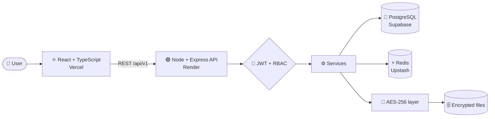

<div align="center">

# 🛡️ VaultShield

### Your documents. Encrypted. Versioned. Shared on *your* terms.

A secure document management & collaboration platform: upload, organise, version and share files inside an encrypted workspace, with role-based access on every action.


**[🚀 Live Demo](https://YOUR-VERCEL-PRODUCTION-URL.vercel.app)** · **[❤️ API Health](https://vaultshield-6r4w.onrender.com/health)** · **[🐛 Report a Bug](https://github.com/harips-21/VAULTSHIELD/issues)**

</div>

---

> ⏳ **Heads-up:** the backend runs on Render's free tier and sleeps after ~15 minutes of inactivity. The **first request can take 50 seconds or more**. Open the [health link](https://vaultshield-6r4w.onrender.com/health) first to wake it up, then log in.

---

## ✨ What is VaultShield?

Most file-sharing tools treat security as an add-on. VaultShield flips that: **every file is encrypted at rest, every action is permission-checked, and every change is recorded.** Create a workspace for your organisation, invite your team, and collaborate without losing control of who sees what.

## 🔑 Features

| | Feature | What it does |
|---|---|---|
| 🔐 | **Secure auth** | JWT access and refresh tokens, hashed passwords |
| 🏢 | **Workspaces** | Register with an organisation or workspace name, so users belong to an org |
| 📁 | **Documents and folders** | Upload, download, rename, delete (soft delete with restore) and nested folders |
| 🧬 | **AES-256 encryption at rest** | Envelope encryption: each file gets its own key, wrapped by a master key |
| 🕰️ | **Version history** | Every edit creates a new version, and any version can be restored |
| 👥 | **Roles (RBAC)** | Owner / Editor / Viewer permissions per document and folder |
| 🔗 | **Secure share links** | Links with expiry date and password protection |
| 🔎 | **Search and filters** | By name, tag, owner, type or date |
| 📜 | **Activity log** | View, edit, share, download and delete events per document |
| 🌗 | **Responsive UI** | File-explorer layout with light/dark mode |

## 🏗️ Architecture



**Request flow:** `Route → JWT middleware → RBAC check → Validation → Controller → Service → DB`

## 🧰 Tech Stack

| Layer | Technology |
|---|---|
| Frontend | React, TypeScript, Axios, zod |
| Backend | Node.js, Express.js (strict TypeScript) |
| ORM / Migrations | Prisma |
| Database | PostgreSQL (Supabase, session pooler) |
| Cache / Sessions | Redis (Upstash) |
| Security | JWT, password hashing, AES-256 |
| Local dev | Docker + docker-compose |
| Hosting | Vercel (frontend), Render (backend) |

## 🌍 Deployment Map

| Service | Platform | Role |
|---|---|---|
| Frontend | **Vercel** | Serves the React app |
| Backend | **Render** (free) | Express API at `/api/v1` |
| Database | **Supabase** | Managed PostgreSQL |
| Redis | **Upstash** | Sessions, caching, rate limits |

## 🔌 API Overview

Base URL: `https://vaultshield-6r4w.onrender.com/api/v1`

| Method | Endpoint | Auth | Description |
|---|---|---|---|
| POST | `/auth/register` | No | Create an account and workspace |
| POST | `/auth/login` | No | Log in and receive tokens |
| POST | `/documents` | Yes | Upload a document |
| GET | `/documents/:id/versions` | Yes | List version history |
| POST | `/documents/:id/restore/:versionId` | Editor+ | Restore a version |
| POST | `/documents/:id/share` | Owner | Create an expiring, password-protected link |
| GET | `/activity/:docId` | Yes | Activity log for a document |

Health check: `GET /health` returns `{"status":"ok", ...}`

## 🚀 Run It Locally

**Prerequisites:** Node.js 18+, Docker (or a local PostgreSQL and Redis), Git

```bash
# 1. Clone
git clone https://github.com/harips-21/VAULTSHIELD.git
cd VAULTSHIELD

# 2. Backend
cd backend
npm install
cp .env.example .env        # fill in your own values
npx prisma migrate deploy   # create the tables
npm run dev

# 3. Frontend (new terminal)
cd frontend
npm install
npm run dev
```

> If your folders are named differently, adjust the `cd` commands.

### 🔧 Environment Variables

Never commit real values. Keep `.env` in `.gitignore`.

**Backend (Render or local `.env`)**

| Variable | Example / Notes |
|---|---|
| `DATABASE_URL` | `postgresql://postgres.<project-ref>:<PASSWORD>@aws-0-<region>.pooler.supabase.com:5432/postgres` (Supabase **session pooler**, because Render's free tier has no IPv6) |
| `REDIS_URL` | `rediss://...` from Upstash |
| `CLIENT_URL` | Frontend origin(s), comma-separated, no trailing `/` |
| JWT secrets | Long random strings, one per token type (see `.env.example`) |
| Encryption master key | Used to wrap per-file keys (see `.env.example`) |

**Frontend (Vercel)**

| Variable | Value |
|---|---|
| `VITE_API_URL` | `https://vaultshield-6r4w.onrender.com/api/v1` |

> Vite bakes env vars in at build time, so **redeploy** the frontend after changing `VITE_API_URL`.

## ☁️ Deploy Your Own

1. **Supabase:** create a project and copy the **Session pooler** connection string.
2. **Upstash:** create a Redis database and copy the `rediss://` URL.
3. **Render:** new Web Service from this repo. Build command: `npm install && npx prisma generate && npx prisma migrate deploy && npm run build`. Set the backend env vars above.
4. **Vercel:** import the repo, set `VITE_API_URL`, then deploy.
5. Add your Vercel URL to `CLIENT_URL` on Render so CORS allows it.

## 🧗 Challenges and Lessons

- **Per-file key design:** solved with envelope encryption (a key per file, wrapped by a master key).
- **Redis and PostgreSQL consistency:** careful cache invalidation so cached metadata matches the source of truth.
- **RBAC cascading:** folder-level roles resolve down to nested documents.
- **Going live:** CORS allow-lists, API base-path mismatches (`/api/v1`), IPv6-free pooler connections and running Prisma migrations against a hosted database.

## 🗺️ Roadmap

- [ ] Sharing UI polish (expiry and password flow)
- [ ] Final dashboard responsiveness pass
- [ ] More unit and integration test coverage
- [ ] Persistent object storage (Render's free disk is temporary)

## ⚠️ Demo Notes

- Free-tier storage is **ephemeral**, so uploaded files may disappear after a restart. **Please don't upload confidential documents to the demo.**
- Supabase free projects pause after 7 days of inactivity.

## 👩‍💻 Author

**Haripriya J** · B.E. Computer Science and Engineering, SRM Easwari Engineering College
🐙 [GitHub: harips-21](https://github.com/harips-21)

---

<div align="center">

⭐ If you found this useful, give the repo a star!

</div>